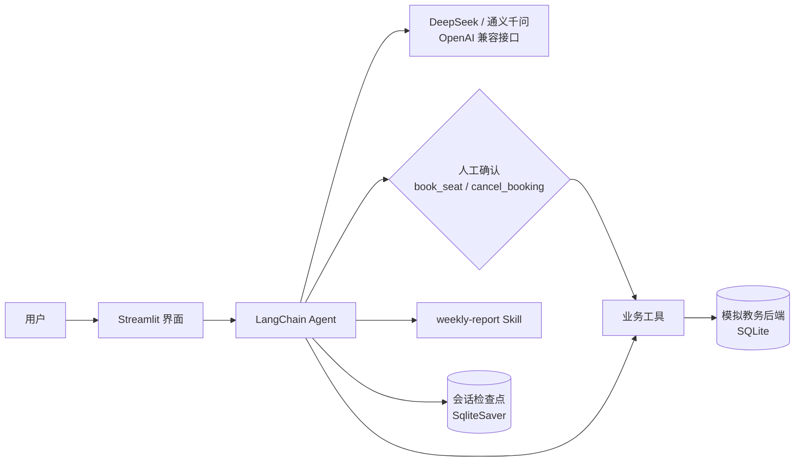

# 校园自习室座位预约助手

一句话完成「查空位 → 挑座位 → 确认预约」，取消预约、生成自习周报同样一句话搞定。

- **课程**：开源 AI 技术实践 · 期末考查
- **路径**：B（在普通应用中加入 Agent 能力）
- **解决的问题**：同学找自习座位时，要在多个页面查空位、核对时段、再提交表单。本项目把座位查询、预约、取消、统计做成业务接口，由智能体理解自然语言后调用，提交和取消前必须由本人确认。

## 核心设计

| 设计点 | 说明 |
| --- | --- |
| 业务后端可独立使用 | `backend/campus_api.py` 是一个模拟教务后端（SQLite），提供 6 个业务接口，不依赖大模型也能直接调用和测试 |
| 自然语言驱动多步业务 | Agent 通过 Tool Calling 串联接口，例如先查靠窗空位、再挑座位预约，一句话完成 |
| 危险操作人工确认 | `book_seat`（提交）与 `cancel_booking`（删除）执行前暂停，界面弹出确认卡片，本人点「确认执行」后才落库，拒绝则不执行 |
| 失败可解释 | 日期越界、时段已开始、座位冲突、同时段重复、单日超限等情况，都会返回中文原因和下一步建议 |
| 过程可见 | 每轮回答上方展示调用了哪个工具、参数是什么、返回了什么 |
| 周报 Skill | `skills/weekly-report/SKILL.md` 规定周报流程，统计数字由后端计算，模型只补充学习建议，周报文件写入 `workspace/` |



## 技术栈

| 层 | 选型 |
| --- | --- |
| 模型 | DeepSeek `deepseek-v4-pro`（OpenAI 兼容接口）；改两行 `.env` 即可换成阿里百炼 `qwen-plus` |
| Agent 框架 | LangChain 1.x `create_agent` + `HumanInTheLoopMiddleware`，LangGraph `SqliteSaver` 保存多轮会话 |
| 业务接口 | 自建模拟教务后端（SQLite） |
| 工具 | `list_rooms`、`query_free_seats`、`book_seat`、`my_bookings`、`cancel_booking`、`export_weekly_report`、`read_skill` |
| Skill | `weekly-report`（符合 Agent Skills 规范：`SKILL.md` + 模板） |
| 界面 | Streamlit |

## 环境要求

- Windows 10/11
- Python 3.10 及以上（开发使用 3.11）
- 模型 API Key：[DeepSeek 开放平台](https://platform.deepseek.com/) 或 [阿里百炼控制台](https://bailian.console.aliyun.com/) 申请

## 安装与启动（Windows PowerShell）

```powershell
git clone https://gitee.com/kkbushishou/campus-seat-agent.git
cd campus-seat-agent
python -m venv .venv
.venv\Scripts\activate
pip install -r requirements.txt -i https://mirrors.aliyun.com/pypi/simple/
copy .env.example .env
```

> 备用地址（GitHub）：`https://github.com/4444wjt/campus-seat-agent.git`

用记事本打开 `.env`，填写 `OPENAI_API_KEY`，然后启动：

```powershell
streamlit run app.py
```

浏览器打开 http://localhost:8501 。首次启动会自动生成以今天为基准的演示数据。

重置演示数据：

```powershell
python -c "from backend.campus_api import init_db; init_db(reset=True)"
```

运行测试（不需要 API Key）：

```powershell
python -m pytest tests -q
```

`.env.example` 内容：

```
OPENAI_API_KEY=
LLM_BASE_URL=https://api.deepseek.com
LLM_MODEL=deepseek-v4-pro
# 改用阿里百炼时：
# LLM_BASE_URL=https://dashscope.aliyuncs.com/compatible-mode/v1
# LLM_MODEL=qwen-plus
```

## 推荐演示话术

| 话术 | 触发的能力 |
| --- | --- |
| 明天下午图书馆三楼还有靠窗的空位吗？ | `query_free_seats`，按靠窗过滤 |
| 帮我约明天 14:00-16:00 三楼一个靠窗空位 | 查空座 → `book_seat`，弹出确认卡片 |
| 我有哪些预约？把后天那个取消掉 | `my_bookings` → `cancel_booking`，弹出确认卡片 |
| 把我本周的预约整理成周报 | `read_skill` → `my_bookings` → `export_weekly_report`，生成 `workspace/weekly_report_日期.md` |
| 帮我约昨天的座位 | 识别为过去日期，不发起预约，给出中文原因和下一步建议（即使调用工具，后端规则也会拒绝） |

## 相对课堂 demo 的改动

| 课堂实验 | 本项目的使用与增量 |
| --- | --- |
| demo_2 工具调用、流式输出 | 工具换成自建业务接口；执行过程面板展示每次工具调用 |
| demo_3 / demo_4 云端模型调用、密钥管理 | 同样走 OpenAI 兼容接口，DeepSeek 与百炼改配置即可切换，Key 只放本地 `.env` |
| demo_5 Skills、权限思想 | 新写 `weekly-report` Skill；周报只写入 `workspace/` |
| 新增 | 自建模拟教务后端与预约规则；提交/删除类操作的人工确认；「一句话多步操作」的业务闭环；后端与 Agent 流程的自动化测试 |

## 目录结构

```
campus-seat-agent/
├── app.py                   # 界面入口
├── agent/
│   ├── seat_agent.py        # Agent 组装：模型、工具、人工确认、会话保存
│   └── tools.py             # 业务工具
├── backend/
│   ├── campus_api.py        # 模拟教务后端与预约规则
│   └── seed.py              # 演示数据
├── skills/weekly-report/    # 周报 Skill
├── prompts/                 # 系统提示词
├── tests/                   # 后端规则与 Agent 流程测试
├── slides/index.html        # 项目介绍幻灯片
└── workspace/               # 周报产出目录
```

## 合规说明

- 学号、姓名、预约记录均为虚构样例，不采集任何真实个人信息。
- API Key 只保存在本地 `.env`，已被 `.gitignore` 排除。
- 预约规则仅为演示，实际以学校官方通知为准。

## 参考与致谢

- 课程仓库：[nicezack/ai-opensource-practice-course](https://gitcode.com/nicezack/ai-opensource-practice-course)（demo_2、demo_5 的工具调用与 Skills 思路）
- 基座项目：[lhh737/LangChain-ReAct-Agent](https://github.com/lhh737/LangChain-ReAct-Agent)，MIT License，Copyright (c) to Rookie。沿用其 Agent → 工具 → Streamlit 的结构与中间件写法，业务、工具、提示词与界面交互均已重写。
- LangChain、LangGraph、Streamlit 官方文档（Human-in-the-loop 章节）
- 开发过程中使用了 AI 编程助手，核心逻辑可逐行解释。
